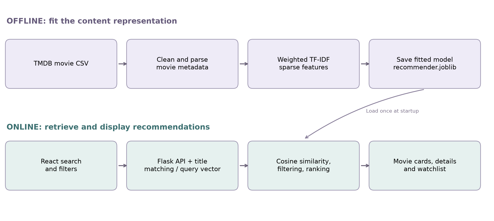
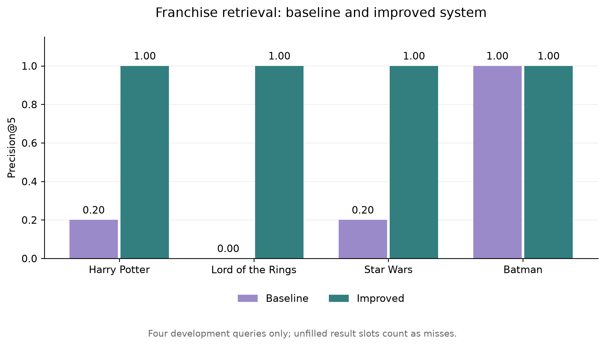

# MACHINE LEARNING MINI PROJECT REPORT

**Project Title: Frame — Content-Based Movie Recommendation System**

## 1. Abstract

Frame is a movie recommendation application designed to help users discover films using a movie title, a genre, or descriptive keywords. It addresses the limitations of exact-title searches and simple keyword filtering, which can miss relevant films or return unrelated results. The system uses content-based information retrieval with TF-IDF feature extraction and cosine similarity. Movie overviews, keywords, genres, and titles are represented as weighted numerical features. Title normalization, partial-title matching, and character n-gram matching improve the handling of incomplete and misspelled queries.

The application uses a catalog of 4,803 movies, a Flask backend, and a responsive React interface. The fitted content representation contains 48,806 features and is stored in a compressed model artifact of approximately 4.7 MB. On a development benchmark of four franchise queries, mean Precision@5 increased from 0.35 for the baseline to 1.00 for the improved retrieval pipeline. These results apply only to the selected queries and do not establish general recommendation accuracy. Twelve backend tests and fourteen browser tests passed. The project demonstrates a local recommendation system using traditional text-processing and ML techniques without a generative model.

## 2. Introduction

### 2.1 Background of the Project

Large movie catalogs offer many viewing choices, but identifying a suitable film can require considerable searching. Titles alone do not describe a movie's themes, setting, or narrative. Content-based recommendation addresses this problem by comparing descriptive attributes of items and retrieving related items.

Established research describes content-based recommendation using item representations, text features, and similarity measures [1–3]. This project applies these methods to movie metadata. A user can search using a favorite film, an incomplete title, or themes such as space exploration.

### 2.2 Problem Statement

Exact string matching fails when a user enters a title with different capitalization, incomplete wording, or a spelling mistake. Simple substring searches can also retrieve incidental mentions of a film and return results in dataset order rather than relevance order.

The problem addressed is to develop a movie discovery system that interprets common search variations, ranks films using their content, and presents understandable recommendations through a usable interface.

### 2.3 Objectives of the Project

- Represent movie content using TF-IDF features.
- Retrieve related films using cosine similarity.
- Support exact, partial, and approximately matched movie titles.
- Apply genre and minimum-rating filters.
- Display summaries, ratings, and reasons for recommendations.
- Provide a responsive interface and a browser-based watchlist.
- Compare the improved pipeline with the original baseline using a documented retrieval metric.

### 2.4 Scope of the Project

The system recommends movies from a fixed local catalog. Its main inputs are movie titles, genres, themes, and optional filters. It supports catalog browsing, title suggestions, movie details, and saved watchlists.

The implementation does not learn from individual viewing histories or user-rating matrices. Watchlist storage does not retrain the model. Ratings are historical values from the dataset. Collaborative filtering, live streaming availability, and general conversational reasoning are outside the implemented scope.

## 3. Dataset Description

### 3.1 Dataset Source

The project uses the local file `tmdb_5000_movies.csv`, corresponding to the TMDB 5000 Movie Dataset distributed through [Kaggle](https://www.kaggle.com/datasets/tmdb/tmdb-movie-metadata). The project uses the movies file; a separate credits file is not required.

### 3.2 Number of Records and Features

| Property | Verified value |
| --- | ---: |
| Original movie records | 4,803 |
| Original columns | 20 |
| Records retained after preprocessing | 4,803 |
| Missing titles | 0 |
| Duplicate movie IDs | 0 |
| Missing overviews | 3 |
| Main fitted TF-IDF dimensions | 48,806 |

The original columns include titles, overviews, genres, keywords, ratings, vote counts, financial metadata, release dates, and production information. The model uses selected descriptive columns rather than all twenty columns.

### 3.3 Input Features and Target Variable

| Field | Use in the project |
| --- | --- |
| `overview` | Plot description and thematic vocabulary |
| `keywords` | Explicit topics and movie-related concepts |
| `genres` | Content representation and filtering |
| `title` | Content representation and title matching |
| `vote_average` | Minimum-rating filter and ranking adjustment |
| `vote_count` | Adjustment for the amount of rating evidence |
| `id` | Unique identification and duplicate handling |
| `release_date`, `runtime` | Information displayed in the interface |

There is **no supervised target variable**. The system fits a content representation and performs similarity-based retrieval. It does not predict a genre class or a user's numerical rating. The existing `vote_average` column is metadata, not a prediction target.

### 3.4 Data Preprocessing Techniques Used

1. Load the CSV using pandas.
2. Remove records without titles and duplicate movie IDs. The supplied file contained neither condition, so all 4,803 records were retained.
3. Replace the three missing overviews with empty strings.
4. Parse JSON-encoded genre and keyword lists and extract their names.
5. Convert genre and keyword names into searchable text.
6. Normalize search titles using lowercase conversion, accent normalization, punctuation removal, and whitespace normalization.
7. Apply English stop-word removal, unigram/bigram extraction, and TF-IDF weighting.
8. Store the feature matrix in sparse form using 32-bit floating-point values.

Title normalization is used for matching; the original title remains available for display.

## 4. Methodology

### 4.1 Machine Learning Algorithms and Retrieval Methods

The system combines unsupervised text feature extraction with deterministic retrieval and ranking. Its principal methods are TF-IDF, cosine similarity, and approximate title matching.

**TF-IDF feature extraction**

TF-IDF represents words and phrases numerically while reducing the influence of terms found throughout the catalog. The implementation uses `TfidfVectorizer` with sublinear term frequency, smoothed inverse document frequency, and L2 normalization. These settings follow the behavior documented by [scikit-learn](https://scikit-learn.org/stable/modules/generated/sklearn.feature_extraction.text.TfidfVectorizer.html).

For a term occurring f times, the sublinear term frequency is:

`TF = 1 + ln(f), for f > 0`

The smoothed inverse document frequency is:

`IDF = ln((1 + N) / (1 + df)) + 1`

Here, N is the number of catalog records and df is the number containing the term. Each field's TF-IDF vector is normalized before the weighted fields are combined.

**Cosine similarity**

Cosine similarity compares the direction of two feature vectors:

`similarity(a, b) = (a · b) / (||a|| × ||b||)`

For L2-normalized vectors, this equals their dot product. The implementation therefore computes similarities from sparse features on demand. This relationship is documented in [scikit-learn's cosine similarity reference](https://scikit-learn.org/stable/modules/generated/sklearn.metrics.pairwise.cosine_similarity.html).

**Title matching**

The query is checked against normalized titles. An exact match identifies a source movie. A partial title can identify several films, such as the Harry Potter collection. For spelling variations, character n-gram TF-IDF similarity is combined with Python's `SequenceMatcher`.

If no suitable title match is found, the query is transformed into a content-search vector. A small rule-based expansion maps expressions such as “sci-fi” and “romantic” to dataset vocabulary. This expansion does not provide unrestricted natural-language understanding.

### 4.2 System Architecture and Workflow



*Figure 1. Offline model fitting and online recommendation workflow.*

During offline preparation, the CSV is cleaned, text representations are fitted, and the resulting model is saved. At application startup, Flask loads this artifact. During an online request, the system processes the user's query, computes similarity, applies filters, ranks eligible films, and returns structured movie data to React.

### 4.3 Feature Selection and Engineering

Four independent TF-IDF representations are combined:

| Feature group | Assigned weight | Fitted dimensions |
| --- | ---: | ---: |
| Overview | 0.45 | 25,000 |
| Keywords | 0.45 | 15,000 |
| Genres | 0.08 | 276 |
| Title | 0.02 | 8,530 |
| **Total** | **1.00** | **48,806** |

Each feature block is multiplied by the square root of its assigned weight. The blocks are concatenated and the resulting vector is normalized again. The weights are heuristic implementation settings, not parameters optimized through an independent validation study.

A separate character n-gram representation supports title matching. Its dimensions are not included in the main 48,806-feature count.

For a franchise query, the system averages the vectors of matching films and normalizes the result. Actual partial-title matches receive a ranking bonus. For descriptive queries, the title block is omitted from the query representation so words in movie names do not dominate a thematic search.

### 4.4 Ranking and Filtering

Candidate movies must satisfy the selected genre and minimum-rating filters and exceed a small similarity threshold. For exact and corrected single-title queries, the source movie is excluded from the recommendations.

A rating adjustment reduces the influence of films with very few votes:

`AdjustedRating = (v × r + 200 × C) / (v + 200)`

Here, v is the movie's vote count, r is its average rating, and C is the catalog's weighted average rating. The result is divided by ten to form Q. The base ranking score is:

`RankingScore = 0.95 × CosineSimilarity + 0.05 × Q`

Partial-title matches receive an additional bonus of 1.0. Consequently, the final pipeline combines content similarity, a small rating adjustment, and explicit title-matching rules. Its ranking score is not a probability of user enjoyment.

### 4.5 Training and Testing Process

Model fitting consists of learning vocabularies and IDF statistics from all catalog records, constructing the sparse feature matrix, and saving the fitted vectorizers and metadata with joblib.

A conventional supervised 80:20 train–test split was not used because the implementation has no labeled prediction target. Retrieval was assessed using a separate set of four development queries, while automated tests checked application behavior. These queries were used during development and do not form an independent held-out evaluation.

### 4.6 Tools and Technologies Used

| Tool or technology | Purpose |
| --- | --- |
| Python | Backend logic and model development |
| pandas and NumPy | Data processing and numerical operations |
| scikit-learn | TF-IDF extraction and normalization |
| SciPy | Sparse matrix operations |
| joblib | Model persistence |
| Flask and Flask-CORS | HTTP API and frontend access |
| React, JavaScript, HTML, CSS | Responsive interface |
| Axios and Vite | API communication and frontend tooling |
| unittest and Playwright | Backend and browser verification |

## 5. Implementation

### 5.1 System Implementation Details

The backend separates model development, model fitting, API handling, and evaluation into distinct modules.

| File | Responsibility |
| --- | --- |
| `recommender.py` | Feature extraction, title matching, retrieval, and ranking |
| `merge.py` | Fit and save the recommendation artifact |
| `app.py` | Validate requests and expose API endpoints |
| `evaluate.py` | Compare baseline and improved retrieval |
| `test_recommender.py` | Backend regression checks |
| `Chatbot.jsx` | Discovery interface, search, filters, and watchlist |
| `Artwork.jsx` | Locally drawn abstract movie covers |

The frontend sends requests to `POST /recommend`. Supporting routes provide catalog browsing, title suggestions, available genres, and backend readiness.

The saved artifact contains movie metadata, fitted vectorizers, sparse content features, and title-matching features. It replaces the earlier dense matrix of every movie pair.

### 5.2 Important Code Snippets

**Weighted feature extraction — excerpt from the implementation**

```python
FIELD_WEIGHTS = {
    "overview": 0.45,
    "keywords_text": 0.45,
    "genres_text": 0.08,
    "title": 0.02,
}

vectorizer = TfidfVectorizer(
    stop_words="english",
    ngram_range=(1, 2),
    sublinear_tf=True,
    max_features=25000 if field == "overview" else 15000,
    strip_accents="unicode",
    dtype=np.float32,
)
blocks.append(vectorizer.fit_transform(movies[field]) * np.sqrt(weight))
features = normalize(hstack(blocks, format="csr")).astype(np.float32)
```

The vectorizer is created inside a loop over the feature groups. This allows the fields to contribute at different weights.

**Similarity for a matched title or collection**

```python
centroid = normalize(
    np.asarray(self.features[seeds].mean(axis=0))
)
scores = np.asarray(self.features @ centroid.T).ravel()
```

For a single matched title, the centroid is its normalized content vector. For a partial franchise query, it represents multiple matching films.

**Candidate filtering and ranking**

```python
eligible = self._eligible(genre, min_rating) & (scores > 0.025)
ranking = scores * 0.95 + self.quality * 0.05

if mode.endswith("partial_title"):
    ranking[seeds] += 1.0
elif seeds:
    eligible[seeds] = False
```

These excerpts illustrate the implemented algorithm; they are not standalone programs.

### 5.3 Screenshots of the Application and Output


*Figure 2. Desktop discovery interface with movie cards, genre filters, ratings, and watchlist controls.*


*Figure 3. Results for a partial-title search using “harry potter”.*

[Mobile discovery screenshot](assets/discover-mobile.png) and [mobile search screenshot](assets/harry-potter-mobile.png) demonstrate the responsive layout.

The covers shown in the application are abstract SVG illustrations, not official film posters.

## 6. Results and Evaluation

### 6.1 Model Outputs

The system produces ranked movie recommendations rather than predicted class labels or numerical user ratings. For the query `harry potter`, the top five results were:

1. Harry Potter and the Chamber of Secrets
2. Harry Potter and the Prisoner of Azkaban
3. Harry Potter and the Goblet of Fire
4. Harry Potter and the Order of the Phoenix
5. Harry Potter and the Half-Blood Prince

The misspelled query `interstelar` was matched to *Interstellar*. The phrase `romantic comedy` was treated as a genre-based content query, requiring both Romance and Comedy genres.

### 6.2 Evaluation Metric

Precision@5 was used for the development benchmark:

`Precision@5 = Number of relevant films in the first five result positions / 5`

Relevance was defined using explicit franchise title rules. The Lord of the Rings rule also accepted The Hobbit films, while the Batman rule accepted Dark Knight titles. Empty result positions counted as misses, so returning one relevant film out of two results gives a score of 1/5 under this definition.

The mean score was the arithmetic average across the four queries.

### 6.3 Baseline Comparison

The baseline used the original retrieval logic: exact-title similarity retrieval when a title matched exactly; otherwise, the first five matching tag rows. The improved pipeline added normalized and approximate title retrieval, weighted TF-IDF features, and ranking adjustments.

| Development query | Baseline Precision@5 | Improved Precision@5 |
| --- | ---: | ---: |
| harry potter | 0.20 | 1.00 |
| lord of the rings | 0.00 | 1.00 |
| star wars | 0.20 | 1.00 |
| batman | 1.00 | 1.00 |
| **Mean** | **0.35** | **1.00** |



*Figure 4. Comparison on four explicitly specified development queries.*

The mean improvement was 0.65, or 65 percentage points. For example, the baseline returned one Harry Potter film and *Epic Movie*, whereas the improved system filled the first five positions with Harry Potter titles.

This comparison measures the complete retrieval pipelines. It does not isolate the effect of TF-IDF from improvements in title matching, ranking, or other heuristics.

### 6.4 Functional Verification

| Verification category | Result |
| --- | --- |
| Backend regression tests | 12 passed |
| Desktop browser tests | 7 passed |
| Mobile browser tests | 7 passed |

Checks covered partial titles, title misspellings, capitalization, genre phrases, filters, invalid input, empty results, API access, suggestions, watchlist persistence, movie details, error recovery, and responsive layout. Functional test success is separate from recommendation relevance.

### 6.5 Model Storage

The compressed fitted model occupies approximately 4.7 MB. The previous dense similarity matrix occupied approximately 92 MB. The new implementation stores sparse features and computes query similarities when requested. This demonstrates a smaller saved representation; it is not a measured inference-speed comparison.

### 6.6 Limitations of the Evaluation

The score of 1.00 applies only to the four selected development queries. It must not be reported as “100% model accuracy.” The queries are franchise-focused, relevance uses title rules, and the test set is small.

Classification accuracy, MAE, and RMSE were not reported because the system does not predict class labels or ratings. Recall and F1-score were not measured. Broader assessment would require a larger held-out query set, human relevance judgments, and evaluation of thematic searches, diversity, and user satisfaction.

## 7. Conclusion

The project developed a functioning content-based movie recommendation application using TF-IDF features, cosine similarity, and practical title-matching methods. It integrates a local ML backend with a responsive interface supporting discovery, filtering, film details, and a watchlist.

The improved pipeline handled incomplete titles and common misspellings, produced relevant franchise results in the development benchmark, and reduced the size of the saved recommendation representation. Automated testing verified the main backend and browser interactions.

The project provided experience in data preprocessing, text feature engineering, sparse matrix operations, model persistence, API development, retrieval evaluation, and interface integration. Future work can include independent relevance evaluation, systematic weight tuning, and personalization if suitable user-feedback data becomes available.

## 8. References

1. G. Adomavicius and A. Tuzhilin, “Toward the Next Generation of Recommender Systems: A Survey of the State-of-the-Art and Possible Extensions,” *IEEE Transactions on Knowledge and Data Engineering*, vol. 17, no. 6, pp. 734–749, 2005. [DOI](https://doi.org/10.1109/TKDE.2005.99); [author-hosted paper](https://pages.stern.nyu.edu/~atuzhili/pdf/TKDE-Paper-as-Printed.pdf).

2. G. Salton and C. Buckley, “Term-weighting approaches in automatic text retrieval,” *Information Processing & Management*, vol. 24, no. 5, pp. 513–523, 1988. [DOI](https://doi.org/10.1016/0306-4573(88)90021-0).

3. G. Salton, A. Wong, and C. S. Yang, “A Vector Space Model for Automatic Indexing,” *Communications of the ACM*, vol. 18, no. 11, pp. 613–620, 1975. [DOI](https://doi.org/10.1145/361219.361220).

4. TMDB, “TMDB 5000 Movie Dataset,” Kaggle. [Dataset page](https://www.kaggle.com/datasets/tmdb/tmdb-movie-metadata).

5. scikit-learn contributors, “TfidfVectorizer.” [Official documentation](https://scikit-learn.org/stable/modules/generated/sklearn.feature_extraction.text.TfidfVectorizer.html).

6. scikit-learn contributors, “cosine_similarity.” [Official documentation](https://scikit-learn.org/stable/modules/generated/sklearn.metrics.pairwise.cosine_similarity.html).

7. Pallets Projects, “Flask Documentation.” [Official documentation](https://flask.palletsprojects.com/en/stable/).

8. React contributors, “React Documentation.” [Official documentation](https://react.dev/).

The research papers are methodological foundations for the implemented approach. The exact feature weights, title-matching rules, filters, and interface are project-specific implementation choices.
